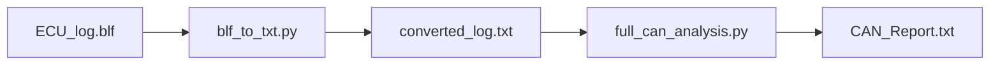

# CAN Log Analysis Tool

Automotive CAN/CAN FD log analysis tool developed using Python for ECU communication investigation, vehicle network analysis, and CANoe trace processing.

## Overview

This project provides an end-to-end workflow for analyzing CAN/CAN FD communication logs. The tool converts native BLF log files generated by Vector CANoe into a readable text format and performs automated analysis of CAN messages.

The framework identifies unique CAN IDs, calculates message occurrence statistics, analyzes cycle times, evaluates DLC distributions, performs byte-level payload inspection, and detects potential rolling counters commonly used in automotive communication.

## Features

- BLF to TXT Conversion
- Unique CAN ID Detection
- Message Occurrence Analysis
- Cycle Time Calculation
- DLC Distribution Analysis
- Byte-Level Payload Analysis
- Rolling Counter Detection
- Automated Report Generation
- Support for Large CAN Logs

## Workflow



## Repository Structure

```text
can-log-analysis-tool/
│
├── blf_to_txt.py
├── full_can_analysis.py
├── CAN_log_analysis_flowchart.mmd
├── README.md
└── LICENSE
```

## Technologies Used

- Python
- Vector CANoe
- CAN
- CAN FD
- VS Code
- GitHub

## Applications

- ECU Validation
- Vehicle Network Analysis
- CANoe Trace Investigation
- Automotive Diagnostics
- Communication Timing Analysis
- CAN Message Reverse Engineering

## Example Capabilities

The tool can:

- Find all unique CAN IDs in a trace
- Count message occurrences
- Calculate average cycle times
- Analyze payload byte behavior
- Detect potential rolling counters
- Generate structured reports for further investigation

## Future Enhancements

- Native BLF Analysis
- CSV Export
- Excel Report Generation
- DBC-Based Signal Decoding
- CRC/Checksum Detection
- Interactive Dashboard
- Signal Change Visualization

## Disclaimer

This repository contains analysis tools only.

No proprietary customer logs, DBC files, ARXML files, ECU software, vehicle data, or company-confidential information are included in this repository.

## Author

**Laxman Birajdar**

Automotive Software & Validation Enthusiast

Tools:
- Python
- CANoe
- CAN / CAN FD
- ECU Validation
- Automotive Networking

